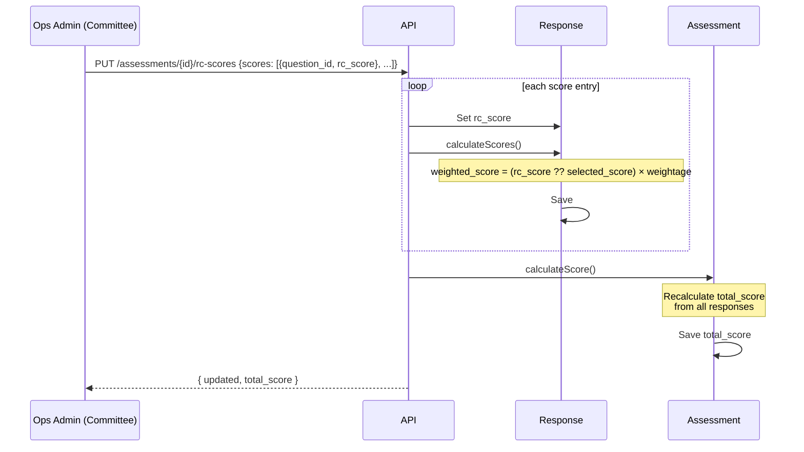

# Assessment Score Calculation Logic

**Location**: `docs/20-features/assessment-score-calculation.md`

**Related**: [Assessment Lifecycle](assessment-lifecycle-end-to-end.md) | [Assessment API](../30-api/34-assessment-api.md)

---

## Overview

The QCI SAMAR assessment scoring system uses a **two-tier score** approach at the response level:

1. **Assessor Score** (`selected_score`) - Initial score assigned by the assessor during assessment
2. **Committee RC Score** (`rc_score`) - Committee-approved score during review (takes precedence when present)

There is **no persisted `final_score` column** on `application_assessment_responses`. The effective score (`rc_score ?? selected_score`) is computed inline, purely to derive `weighted_score` — it is never stored on its own.

This approach ensures committee oversight while preserving the original assessor's input for audit purposes.

---

## Score Fields (per response)

The `application_assessment_responses` table stores three key score fields:

| Field | Description | Set By | Nullable |
|-------|-------------|--------|----------|
| `selected_score` | Assessor's original score based on selected option | Assessor | No (once answered) |
| `rc_score` | Committee's approved score (Rating Committee score) | Committee | Yes (only when committee overrides) |
| `weighted_score` | `(rc_score ?? selected_score) × (weightage / 100)` | System | No (once calculated) |

---

## Calculation Formula

### Per Question

```
1. Determine selected_score from assessor's option
2. Compute the effective score (not persisted): effective = rc_score ?? selected_score
3. Calculate weighted_score:
   weighted_score = effective × (weightage / 100)
```

### Per Parameter

```
parameter_score = SUM(weighted_score) of all questions in parameter
```

### Total Assessment (Rating)

```
total_score = SUM(parameter_scores) / COUNT(parameters)
```

The resulting rating is on a **0-5 scale** and determines the certification level.

---

## Detailed Example

### Scenario: Manufacturing Assessment with 1 Parameter, 3 Questions

**Parameter**: Quality Management System
**Questions**:

| Question | Weightage | Assessor Score | RC Score | Effective Score | Calculation | Weighted Score |
|----------|-----------|----------------|----------|-------------|-------------|----------------|
| Q1: Document Control | 20% | 3 | **4** | **4** | 4 × 0.20 | **0.80** |
| Q2: Process Control | 30% | 2 | - | **2** | 2 × 0.30 | **0.60** |
| Q3: Quality Records | 50% | 5 | **3** | **3** | 3 × 0.50 | **1.50** |

**Calculation Steps**:

1. **Q1**: Committee overrode assessor's score of 3 with RC score of 4
   - Effective Score = 4 (RC score takes precedence)
   - Weighted Score = 4 × 0.20 = 0.80

2. **Q2**: No committee override
   - Effective Score = 2 (assessor's original score)
   - Weighted Score = 2 × 0.30 = 0.60

3. **Q3**: Committee downgraded assessor's score of 5 to 3
   - Effective Score = 3 (RC score takes precedence)
   - Weighted Score = 3 × 0.50 = 1.50

4. **Parameter Score**: 0.80 + 0.60 + 1.50 = **2.90**

5. **Total Score**: 2.90 / 1 parameter = **2.90** → **Level 3** certification

---

## Certification Levels

The final assessment rating (total_score) determines the certification level:

| Score Range | Certification Level | Description (illustrative — not in code) |
|-------------|---------------------|-------------|
| 0.0 - 1.5 | **Level 1** | Basic compliance |
| >1.5 - 2.5 | **Level 2** | Developing systems |
| >2.5 - 3.5 | **Level 3** | Established systems |
| >3.5 - 4.5 | **Level 4** | Advanced systems |
| >4.5 - 5.0 | **Level 5** | World-class systems |

**Note**: Ranges use "greater than" for lower bound (except Level 1) and "less than or equal to" for upper bound.

**On the description labels**: the only authoritative grade output is the `"Level {N}"` string produced by `Assessment::ratingLevelFromScore()` from the score bands above. The "Basic compliance / Developing systems / …" descriptions are editorial only — they appear nowhere in the codebase and must not be relied on as canonical.

---

## When Scores Recalculate

The system **automatically recalculates** scores in these scenarios:

### 1. Committee Submits RC Scores (Bulk)

**Trigger**: Rating Committee flushes RC score overrides during committee review (Certify or Send Back both flush first)
**Endpoint**: `PUT /api/v1/assessments/{id}/rc-scores`

**What Happens** ([`AssessmentController::updateRcScores()`](../../app/Http/Controllers/Api/V1/AssessmentController.php)):
1. Requires the assessment to be in `committee_review` status.
2. Validates `scores` as an array of `{question_id, rc_score}` — `rc_score` is an **integer, 1–5** (not a decimal).
3. For each entry, updates the matching response's `rc_score`, calls `calculateScores()`, and saves.
4. Calls `$assessment->calculateScore()` to recompute the assessment total **immediately** in the same request.

There is **no per-question `POST .../rc-score` or `POST .../approve` endpoint** — `ApplicationAssessmentQuestionFeedbackController` does not have `storeRcScore()` or `approve()` methods. Per-question review status (`review_status`, `review_type`) is set by the QC/committee send-back and address-feedback flows, not by a dedicated approve endpoint.

### 2. Manual Recalculation

**Trigger**: Artisan command for bulk recalculation
**Command**: `php artisan assessments:recalculate-scores [options]`

**Options**:
- `--id=123` - Recalculate specific assessment
- `--status=submitted_for_qc` - Recalculate by status
- `--dry-run` - Preview changes without saving

**What Happens**:
1. Recalculates all response scores (`weighted_score`)
2. Recalculates assessment total score
3. Displays before/after scores

**Caveat — `--dry-run` ignores RC-score precedence**: the real run recalculates each response via `ApplicationAssessmentResponse::calculateScores()`, which uses the effective score `rc_score ?? selected_score`. The dry-run preview path (`RecalculateAssessmentScores::previewScore()`) computes `weighted_score` from `selected_score` only, disregarding any committee `rc_score`. For an assessment that has committee overrides, the dry-run's predicted total can therefore differ from what an actual run produces. Treat the preview as indicative, not exact, whenever RC scores are present.

**Code**: [`RecalculateAssessmentScores` command](../../app/Console/Commands/RecalculateAssessmentScores.php)

**Example Usage**:
```bash
# Preview recalculation for all assessments in QC
php artisan assessments:recalculate-scores --status=submitted_for_qc --dry-run

# Actually recalculate assessment ID 42
php artisan assessments:recalculate-scores --id=42

# Recalculate all assessments with responses
php artisan assessments:recalculate-scores
```

---

## API Endpoints

### Update RC Scores (Bulk)

**Endpoint**: `PUT /api/v1/assessments/{id}/rc-scores`

**Authorization**: Operations Admin (`committeeDecision` gate); assessment must be in `committee_review` status.

**Request Body**:
```json
{
  "scores": [
    { "question_id": 456, "rc_score": 4 },
    { "question_id": 457, "rc_score": 3 }
  ]
}
```

**Validation Rules**:
- `scores`: Required array, min 1
- `scores.*.question_id`: Required integer
- `scores.*.rc_score`: Required integer, min 1, max 5

**Response** (200 OK):
```json
{
  "success": true,
  "message": "RC scores updated successfully.",
  "data": {
    "updated_count": 2,
    "updated": [
      { "question_id": 456, "rc_score": 4, "weighted_score": 0.80 },
      { "question_id": 457, "rc_score": 3, "weighted_score": 1.50 }
    ],
    "total_score": 2.90
  }
}
```

**Side Effects**:
1. Updates each response's `rc_score`, recalculates its `weighted_score`
2. Recalculates the assessment's `total_score` in the same request
3. Entries referencing a question with no existing response are reported back as warnings, not hard failures (unless none of the entries resolved to a response, which is a 400)

This bulk endpoint is what both **Certify** and **Send Back** call first from the Rating Committee screen (`ReviewAssessmentParameter.jsx`) to flush pending RC overrides before firing `certify` or `committee_feedback`. See [Assessment Lifecycle §4.7](assessment-lifecycle-end-to-end.md#47-committee_review).

---

## Database Schema

### application_assessment_responses

Stores scores at the question response level.

```sql
CREATE TABLE application_assessment_responses (
    id BIGINT UNSIGNED PRIMARY KEY AUTO_INCREMENT,
    assessment_id BIGINT UNSIGNED NOT NULL,
    question_id BIGINT UNSIGNED NOT NULL,
    selected_option INT, -- 1-5 (assessor's choice)

    -- Score fields (added in migration 2026_02_03_085902)
    selected_score DECIMAL(5,2), -- Score for selected_option (1-5)
    rc_score DECIMAL(5,2) NULL COMMENT 'Committee approved score (1-5)',
    weighted_score DECIMAL(10,2) COMMENT '(rc_score ?? selected_score) × (weightage/100)',

    assessor_remarks TEXT NULL,
    assessed_by BIGINT UNSIGNED NULL,
    assessed_at DATETIME NULL,

    created_at TIMESTAMP NULL,
    updated_at TIMESTAMP NULL,

    FOREIGN KEY (assessment_id) REFERENCES application_assessments(id) ON DELETE CASCADE,
    FOREIGN KEY (question_id) REFERENCES application_assessment_questions(id) ON DELETE CASCADE,
    FOREIGN KEY (assessed_by) REFERENCES users(id) ON DELETE SET NULL
);
```

**Key Points**:
- `rc_score` is **nullable** (only set when committee provides override)
- There is **no `final_score` column** — the effective score is computed inline and only `weighted_score` is persisted
- `weighted_score` includes decimal precision for accurate calculations

### application_assessments

Stores the total assessment score (rating).

```sql
CREATE TABLE application_assessments (
    id BIGINT UNSIGNED PRIMARY KEY AUTO_INCREMENT,
    application_id BIGINT UNSIGNED NOT NULL,
    status VARCHAR(50) NOT NULL,

    -- Total score (rating)
    total_score DECIMAL(5,2) NULL COMMENT 'Total rating: sum of parameter scores / count of parameters',

    -- ... other fields

    created_at TIMESTAMP NULL,
    updated_at TIMESTAMP NULL,
    deleted_at TIMESTAMP NULL
);
```

---

## Code Implementation

### Response Score Calculation

**File**: `app/Models/ApplicationAssessmentResponse.php`

```php
public function calculateScores(): void
{
    if ($this->selected_option === null || ! $this->question) {
        return;
    }

    $this->selected_score = $this->question->getOptionScore($this->selected_option);

    $weightage = $this->question->weightage ?? 0;
    $effectiveScore = $this->rc_score ?? $this->selected_score;
    $this->weighted_score = $effectiveScore * ($weightage / 100);
}
```

**Key Logic**:
1. `selected_score` always reflects assessor's original input
2. `rc_score` may be null (no committee override)
3. The effective score (`rc_score ?? selected_score`) is a local variable, not a persisted column
4. `weighted_score` multiplies the effective score by weightage percentage

**Code Reference**: [`ApplicationAssessmentResponse::calculateScores()`](../../app/Models/ApplicationAssessmentResponse.php)

---

### Assessment Total Calculation

**File**: `app/Models/Assessment.php`

```php
/**
 * Calculate total score (rating) from responses.
 *
 * The rating is calculated as:
 * Rating = Sum of Parameter Scores / Number of Parameters
 *
 * Where each Parameter Score = Sum of weighted_scores for questions in that parameter
 * And weighted_score = (rc_score ?? selected_score) × (weightage / 100)
 *
 * The resulting rating is on a 0-5 scale and determines the certification level:
 * - 0.0 to 1.5 → Level 1
 * - >1.5 to 2.5 → Level 2
 * - >2.5 to 3.5 → Level 3
 * - >3.5 to 4.5 → Level 4
 * - >4.5 to 5.0 → Level 5
 */
public function calculateScore(): void
{
    $responses = $this->responses()
        ->whereNotNull('selected_option')
        ->with('question')
        ->get();

    if ($responses->isEmpty()) {
        $this->update(['total_score' => null]);
        return;
    }

    // Group responses by parameter_id and calculate score per parameter
    $parameterScores = $responses->groupBy(function ($response) {
        return $response->question->parameter_id ?? 0;
    })->map(function ($parameterResponses) {
        return $parameterResponses->sum('weighted_score');
    });

    // Filter out null/zero parameter_ids and get count
    $validParameterScores = $parameterScores->filter(fn($score, $key) => $key !== 0);
    $numberOfParameters = $validParameterScores->count();

    if ($numberOfParameters === 0) {
        $this->update(['total_score' => null]);
        return;
    }

    // Calculate rating: Sum of parameter scores / Number of parameters
    $sumOfParameterScores = $validParameterScores->sum();
    $rating = $sumOfParameterScores / $numberOfParameters;

    // Round to 2 decimal places
    $rating = round($rating, 2);

    $this->update([
        'total_score' => $rating,
    ]);
}
```

**Key Logic**:
1. Groups responses by parameter
2. Sums weighted_scores within each parameter
3. Divides sum of parameter scores by parameter count
4. Rounds to 2 decimal places for consistency

**Code Reference**: [`Assessment::calculateScore()`](../../app/Models/Assessment.php#L569)

---

## Committee Workflow

### RC Score Flush (Bulk)



This single bulk call is what both **Certify** and **Send Back** fire from the Rating Committee review screen before the corresponding `certify` / `committee_feedback` transition.

---

## Unified Question Review Status

The system uses a unified review status tracking mechanism for assessment questions, supporting both QC and committee review workflows.

### Database Columns

The `application_assessment_questions` table tracks per-question review status:

| Column | Type | Description |
|--------|------|-------------|
| `review_status` | enum('pending', 'approved', 'flagged', 'clarified') | Current review status, default 'pending' |
| `review_type` | enum('qc', 'committee'), nullable | Who set the status (QC or committee) |
| `reviewed_by` | FK to users, nullable | User who last reviewed |
| `reviewed_at` | timestamp, nullable | When last reviewed |

### How Review Status Changes

| Action | Affected Questions | review_status | review_type |
|--------|-------------------|---------------|-------------|
| QC approve_for_committee | None | No change (stay pending) | — |
| QC provide_feedback | Flagged questions only | `flagged` | `qc` |
| Assessor addresses QC feedback | ALL questions | Reset to `pending` | Reset to `null` |
| Committee certify | ALL questions | `approved` | `committee` |
| Committee provide_feedback | Flagged questions only | `flagged` | `committee` |
| Assessor addresses committee feedback | ALL questions | Reset to `pending` | Reset to `null` |

### API Response Format

When retrieving assessment responses, each question includes:
```json
{
    "reviewStatus": "flagged",
    "reviewType": "qc",
    "reviewedBy": { "id": 5, "name": "QC Person" },
    "reviewedAt": "2026-02-08T10:30:00Z"
}
```

### Model Methods

```php
// Mark a question as reviewed
$question->markReviewed(
    ApplicationAssessmentQuestion::REVIEW_STATUS_FLAGGED,
    ApplicationAssessmentQuestion::REVIEW_TYPE_QC,
    $userId
);

// Reset (used when assessor addresses feedback)
$question->resetReviewStatus();

// Check status
$question->isFlagged();            // review_status === 'flagged'
$question->isApproved();           // review_status === 'approved'
$question->isFlaggedOrClarified();  // review_status in ['flagged', 'clarified']
```

### Constants

```php
// Review statuses
ApplicationAssessmentQuestion::REVIEW_STATUS_PENDING    = 'pending';
ApplicationAssessmentQuestion::REVIEW_STATUS_APPROVED   = 'approved';
ApplicationAssessmentQuestion::REVIEW_STATUS_FLAGGED    = 'flagged';
ApplicationAssessmentQuestion::REVIEW_STATUS_CLARIFIED  = 'clarified';

// Review types
ApplicationAssessmentQuestion::REVIEW_TYPE_QC        = 'qc';
ApplicationAssessmentQuestion::REVIEW_TYPE_COMMITTEE  = 'committee';
```

---

## Notes & Best Practices

### RC Score Range

- **Column type**: DECIMAL(5,2), nullable (only set when committee provides override)
- **API validation**: the only endpoint that writes it (`PUT /assessments/{id}/rc-scores`) currently restricts input to an **integer 1–5** — the column's decimal precision is not exercised by any existing write path

### Feedback Table vs Response Table

**`application_assessment_question_feedbacks`** (Audit Trail):
- Records history of all committee actions
- Stores each RC score submission separately
- Used for audit and review history
- Multiple entries per question possible

**`application_assessment_responses.rc_score`** (Active Score):
- Stores the **current active** RC score
- Used in actual score calculations
- Single value per question
- Updated when new RC score submitted

### Recalculation Timing

**Immediate Recalculation**:
- Response scores recalculate immediately when RC score is set
- Assessment total recalculates immediately when RC score is submitted
- No need to wait for approval - system handles it automatically

**Batch Recalculation**:
- Use artisan command for data fixes or migrations
- Supports dry-run mode for safety
- Recalculates both response and assessment scores

### Score Precision

- All scores stored as DECIMAL(5,2) for 2 decimal places
- Weighted scores use DECIMAL(10,2) for accumulation precision
- Final rating rounded to 2 decimal places
- Prevents floating-point calculation errors

---

## Troubleshooting

### Q: Why is assessment total_score not updating after RC score submission?

**A**: The assessment total should recalculate automatically when RC score is submitted. If it's not updating, check:

1. Does the response exist? (assessor must have answered the question first)
2. Is the response's `selected_option` set?
3. Check server logs for any errors

**Solution**:
```bash
# Force recalculate specific assessment
php artisan assessments:recalculate-scores --id={assessment_id}
```

---

### Q: How to fix scores after bulk data update?

**A**: Use the recalculate artisan command:

```bash
# Preview changes first (safe)
php artisan assessments:recalculate-scores --dry-run

# Recalculate all assessments with responses
php artisan assessments:recalculate-scores

# Recalculate specific status
php artisan assessments:recalculate-scores --status=submitted_for_qc
```

---

### Q: Can I see the original assessor score after RC override?

**A**: Yes! The `selected_score` field always preserves the assessor's original input. `rc_score` shows the committee override (there is no separate `final_score` column — compute the effective score as `rc_score ?? selected_score` in the query).

**Query Example**:
```sql
SELECT
    question_id,
    selected_score AS assessor_original,
    rc_score AS committee_override,
    COALESCE(rc_score, selected_score) AS effective_score,
    weighted_score
FROM application_assessment_responses
WHERE assessment_id = 123;
```

---

### Q: What happens if committee removes RC score?

**A**: The system doesn't currently support removing RC scores via API. If needed:

**Option 1 - Database Update** (requires admin access):
```sql
UPDATE application_assessment_responses
SET rc_score = NULL
WHERE id = {response_id};
```

Then recalculate:
```bash
php artisan assessments:recalculate-scores --id={assessment_id}
```

**Option 2 - Submit New RC Score**: Override with correct value via the bulk `rc-scores` endpoint.

---

## See Also

**Related Features**:
- [Assessment Lifecycle](assessment-lifecycle-end-to-end.md) - Complete assessment lifecycle, cross-stack

**API Documentation**:
- [Assessment API](../30-api/34-assessment-api.md) - Assessment endpoints
- [API Reference](../30-api/37-api-reference.md) - Complete API specs

**Architecture**:
- [State Machines](../10-architecture/13-state-machines.md) - Assessment workflow states
- [Database Schema](../10-architecture/12-database-schema.md) - Database structure

**Code References**:
- [`ApplicationAssessmentResponse` model](../../app/Models/ApplicationAssessmentResponse.php) - Response score calculation
- [`Assessment` model](../../app/Models/Assessment.php) - Assessment total calculation
- [`AssessmentController::updateRcScores()`](../../app/Http/Controllers/Api/V1/AssessmentController.php) - Bulk RC score API
- [`RecalculateAssessmentScores` command](../../app/Console/Commands/RecalculateAssessmentScores.php) - Batch recalculation
